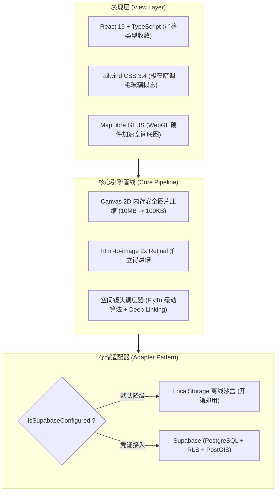

<div align="center">

# ✉️ 未寄 · Unsent

**留在地表上的未寄之信 | A Spatial-Emotional Archive of Unspoken Words**

<p align="center">
  <a href="https://env-00jy5xxt7kdo-static.normal.cloudstatic.cn" target="_blank">
    
  </a>
  <a href="https://unsent-teal.vercel.app/" target="_blank">
    
  </a>
</p>

<p align="center">
  
  
  
  
  
  
  
</p>

> 「留在某个路口、某张长椅，终究未曾寄给对方的话。<br/>
> 在物理坐标里留下心事，等待星夜里陌生人的善意回响。」

</div>

---

## 🌟 在线体验直达 (Live Demos)

本项目已实现多节点高可用部署，支持手机触控与桌面端自适应访问：

| 节点 | 访问入口 | 特性说明 |
| :--- | :--- | :--- |
| **🇨🇳 国内节点** | [**点击直达 (腾讯云托管)**](https://env-00jy5xxt7kdo-static.normal.cloudstatic.cn) | 国内边缘 CDN 高速加速，零墙秒开 |
| **🌐 海外节点** | [**点击直达 (Vercel)**](https://unsent-teal.vercel.app/) | 全球 Anycast 边缘网络，持续自动构建交付 |

---

## 📖 设计哲学与产品灵感

在即时通讯与快节奏社交时代，我们发送了太多浮躁的碎片消息，而草稿箱里那些真正触及灵魂的思绪，却往往沉入海底。

**「未寄 · Unsent」** 是一场关于**空间、时间与人类情绪**的数字化探索实验：
- **物理坐标的仪式感**：每一封信都不再是时间线里被冲刷的信息流，而是永久锚定在地球某个具体的经纬度上（母校的长椅、看日落的防波堤、深夜无人的街角）。
- **时间沉淀的纯粹**：引入时空信封封存机制，让话语在水晶外壳中经历岁月的沉淀与倒计时等待。
- **反戾气的轻社交**：拒绝传统社交的争辩、点踩与评论区审判，仅支持无声的“微光共振”与充满善意的“纸飞机回信”。
- **实体感跨媒介传递**：融合复古拍立得相纸美学，将数字记忆一键烘焙为自带物理经纬度印章与扫码深链接的视觉卡片。

---

## ✨ 核心特性矩阵

```
                ┌─────────────────────────────────────────┐
                │          ✉️ 未寄 · Unsent 功能全景       │
                └────────────────────┬────────────────────┘
          ┌──────────────────────────┼──────────────────────────┐
          ▼                          ▼                          ▼
   🌌 地理与沉浸底图           💫 五维情绪光谱            ⏳ 时空信封锁
  · MapLibre GL 硬件渲染     · 思念/秘密/治愈/释怀/告白   · 晶莹毛玻璃水晶封存
  · ESRI 极夜高分无水印      · 呼吸脉冲波纹动态光晕      · 精确至毫秒的解锁倒计时
          │                          │                          │
          ├──────────────────────────┼──────────────────────────┤
          ▼                          ▼                          ▼
   📷 拍立得与轻量直传        🏷️ 实体感分享海报          ✈️ 纸飞机回音与漫游
  · Canvas 智能等比压缩      · html-to-image 2x 高清导出 · 礼花粒子共振 (Confetti)
  · 手机拍照 / 粘贴 Ctrl+V   · 经纬度印章 + 动态二维码    · 任意门全局随机穿梭
```

### 1. 🌌 极夜无水印数字地表
- 基于 **MapLibre GL** 引擎构建，底层借助 WebGL 硬件加速，保证千级标记点下的 60fps 丝滑平移与视差缩放。
- 采用 **ESRI World Dark Gray** 极夜高分辨率无水印底图，营造深邃纯净的星空观测站质感。

### 2. 💫 五维情绪色彩系统
不同维度的情感在此被赋予专属波长，在深黑地表上绽放呼吸脉冲，并支持顶部一键实时过滤：

| 情绪色彩 | 标签名称 | 代表色值 | 情感意象 |
| :---: | :---: | :---: | :--- |
| 🔵 | **思念微光** | `#38bdf8` | 怀念故人、旧日时光、未完成的遗憾 |
| 🟣 | **秘密树洞** | `#c084fc` | 无法对身边人言说的内心独白与压抑 |
| 🟠 | **温暖治愈** | `#fb923c` | 平凡生活里的微小确幸、善意与鼓励 |
| 🟢 | **释怀前行** | `#34d399` | 挥别过去、看淡离合、重启自我的勇气 |
| 🌹 | **心动告白** | `#fb7185` | 藏在心底不敢开口的青涩暗恋与炽热爱意 |

### 3. ⏳ 时空信封与时间胶囊机制 (Time Capsule)
- 支持将信件封存于未来某个时刻开启（明日、跨年夜、1年后或任意纪念日）。
- 未到期信件以水晶毛玻璃外壳上锁，展示精确到毫秒级的动态倒计时，静候岁月钥匙转动。

### 4. 📷 拍立得相纸与客户端无损轻量压缩
- 搭载自研纯客户端 Canvas 智能等比降采样算法：即使用户上传手机相册拍摄的 5~10MB 超大原图，也会在浏览器端瞬时压缩至 ~100KB，零卡顿且保持极佳观感。
- 支持手机拍照直传、本地拖拽、系统剪贴板 **`Ctrl+V` 一键粘贴截图**及预设美图库。

### 5. 🏷️ 实体感拍立得海报 + 空间深链接
- 融合 `html-to-image` 渲染管线，将信件实时烘焙为 2x 超清拍立得相纸。
- 自动盖印**地理经纬度印章**与**专属时间戳**，海报右下角附带精准坐标 Deep Link 二维码。扫码即可在移动端跨屏直达物理落点并展信。

### 6. ✈️ 微光共振与纸飞机回音
- 点亮微光触发多彩物理烟花（`canvas-confetti`）粒子绽放。
- 无攻击性评论设计，仅允许投递象征善意的“折叠纸飞机”式轻留言。

### 7. 🎲 漫步地表 (任意门巡游模式)
- 点击“漫步地表”，镜头将以航拍视角掠过地球经纬，随机降落在世界某处角落，静静拆阅某位陌生人的过往心境。

---

## 🛠️ 技术深度剖析与架构设计 (Technical Deep Dive)



### 1. WebGL 硬件加速在海量地理数据下的性能调优
- 选用 **MapLibre GL** 替代传统 DOM 型地图库（如原生 Leaflet），采用 GPU 矢量瓦片硬件渲染。
- 标记图层采用微光呼吸 CSS GPU 复合图层（`transform: translate3d` 与 `will-change: transform`），彻底规避频繁重排（Reflow）导致的掉帧。

### 2. 纯前端无依赖图片等比压缩防爆死机制
- 移动端上传 8~10MB 大图常导致移动设备浏览器内存溢出（OOM）崩溃或 Base64 膨胀爆满存储。
- 本项目在 [`CreateCapsuleModal.tsx`](./src/components/Capsule/CreateCapsuleModal.tsx) 中构建了独立的内存安全 Canvas 压降流水线：
  ```ts
  // 核心压缩算法截取：约束最大等比尺寸，质量系数 0.82，体积锐减 98%
  let { width, height } = img;
  const maxDimension = 1000;
  if (width > maxDimension || height > maxDimension) {
    if (width > height) {
      height = Math.round((height * maxDimension) / width);
      width = maxDimension;
    } else {
      width = Math.round((width * maxDimension) / height);
      height = maxDimension;
    }
  }
  ```

### 3. 拍立得 2x Retinal 高清导出与二维码深链接
- 利用 `html-to-image` 将 DOM 树转换为矢量位图时，通过 `pixelRatio: 2` 与 `cacheBust: true` 实现 Retina 视网膜屏幕级的高清输出；
- 动态注入当前胶囊的绝对 URL（`?capsule=<id>`），实现移动端扫码瞬间触发空间镜头调度器平滑飞跃。

### 4. 两级自适应降级存储架构 (Zero-Config First)
- 在 [`src/lib/supabase.ts`](./src/lib/supabase.ts) 中运用**适配器模式（Adapter Pattern）**：
  - **开箱即用**：未配置任何云端环境变量时，自动降级至内置人文地理数据的 LocalStorage 离线模式；
  - **云端持久化**：注入 Supabase 凭据后，无缝切为 PostgreSQL 云端同步，配合 RLS 策略保护用户数据写入。

---

## 📁 规范的工程组织结构

```
game/
├── public/                 # 静态资源与矢量 Favicon
├── src/
│   ├── assets/             # 图片与静态多媒体
│   ├── components/
│   │   ├── Capsule/        # 核心信件胶囊模块
│   │   │   ├── CreateCapsuleModal.tsx # 投递信件（含拍照/图片压缩/锁定机制）
│   │   │   ├── SharePosterModal.tsx   # 拍立得高清海报生成与深链接二维码
│   │   │   └── ViewCapsuleModal.tsx   # 展信交互、水晶倒计时、纸飞机回信
│   │   ├── Map/
│   │   │   └── MapView.tsx            # MapLibre GL 极夜底图与呼吸光标标记
│   │   └── UI/
│   │       └── Header.tsx             # 顶部品牌导航与五维情绪过滤器
│   ├── lib/
│   │   └── supabase.ts     # Supabase 云端与 LocalStorage 降级双模适配器
│   ├── types/
│   │   └── capsule.ts      # TypeScript 强类型契约定义（全流程零 any）
│   ├── App.tsx             # 主应用控制器、深链接路由恢复、漫步飞梭调度
│   ├── index.css           # 极夜底色与毛玻璃 Tailwind 基础指令
│   ├── main.tsx            # 应用挂载入口
│   └── supabase_schema.sql # 完整的数据库表结构与 RLS 安全策略脚本
├── index.html              # HTML 骨架与 SEO Meta
├── package.json            # 依赖声明与现代化构建脚本
├── tailwind.config.js      # 极夜暗色系与五维情绪色盘配置
└── vite.config.ts          # Vite 构建配置
```

---

## 🚀 极速本地运行 (3 步启动)

```bash
# 1. 克隆项目
git clone https://github.com/David-XIa001/unsent.git
cd unsent

# 2. 安装依赖
npm install

# 3. 启动本地开发服务 (支持完整离线体验)
npm run dev
```

---

## 🗺️ 后续功能路线图 (Roadmap)

- [x] **极夜底图与深色模式**：MapLibre GL 硬件加速渲染
- [x] **五维情绪色彩系统**：五彩呼吸波纹与单触过滤
- [x] **时空胶囊与解锁倒计时**：未来信件水晶外壳封存
- [x] **客户端无损图片压缩**：纯前端 Canvas 等比压降
- [x] **拍立得海报与深链接二维码**：一键导出 2x 高清实体卡片
- [x] **漫游地表 (任意门)**：流星般全局镜头飞越巡游
- [ ] **物理近场感应 (Geofencing)**：新增“真身到达方圆 500 米内才可拆阅”的近地信件模式
- [ ] **空间环境音频白噪音**：根据地理区域（海浪、雨声、列车、林间风鸣）动态烘托氛围
- [ ] **多语言国际化 (i18n)**：全量支持 English、日本語、繁體中文切换

---

## 🤝 贡献与交流 (Contributing)

欢迎提交 Issue 与 Pull Request！无论是交互体验改进、性能优化还是 Bug 修复，都期待你的加入。

---

## 📄 许可证 (License)

本项目基于 [MIT License](https://opensource.org/licenses/MIT) 开源，欢迎自由学习、分享与个人使用。

<div align="center">

**愿每一颗在地表闪烁的心事微光，都能在夜空里被温柔以待。** 🌌

</div>
