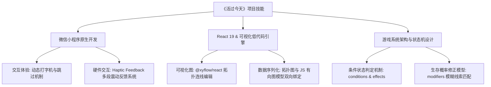

# 🛠️ 《活过今天》项目核心技术能力与实践技能 (Project Skills & Tech Highlights)

本项目深入融合了“跨平台轻量级客户端交互设计”与“低代码可视化图形编辑引擎”的核心理念。以下是本套系统开发过程中所涉及的核心技术能力与架构设计实践，适合作为项目技术栈的技术积淀与展示。

---

## 🗺️ 核心技能图谱 (Core Skills)

---

## 1. 微信小程序硬反馈与高级交互设计 (Mini-Program Interactions)

在小程序中，通过对原生 API 的深度封装，构建了极具交互感和沉浸感的底层引擎：
- **Haptic Feedback (多物理段震动交互)**：
  - **探索/常规选项**：轻触短震动 `wx.vibrateShort({ type: 'light' })` 模拟选项触碰感。
  - **面临暴毙/死亡**：长震动 `wx.vibrateLong()` 模拟心脏骤停的受击硬反馈。
  - **生存过关**：利用定时器串联中短震动组合（如 `medium` + `light` * 2），形成欢快节奏的震动音符，显著提升玩家成就感。
- **高性能打字机输出动效**：
  - 基于 `setInterval` 自主实现了按字符间隔动态渲染的打字机特效，提升文字剧情的可读性。
  - 支持“轻触屏幕任意区域立即跳过”机制，通过缓存拦截与动画瞬间清除，保障了老玩家的快速游戏节奏，解决文字堆叠闪烁及性能卡顿。

---

## 2. React 19 & React Flow 可视化低代码配置系统 (Low-Code Editor Engine)

项目的后台管理系统使用现代前端架构搭建，攻克了数据可视化编辑的难点：
- **复杂有向图 (Directed Graph) 建模**：
  - 借助 React 19 以及全新的 `@xyflow/react` (React Flow 12+)，将小程序的剧情 JSON 配置建模为由 `Nodes` (节点，表示剧情场景) 与 `Edges` (连线，表示玩家决策路径) 构成的有向图。
- **自定义节点与双向数据序列化**：
  - 深度定制 React Flow 节点，在节点内部嵌入输入控件，实现对 `deathRate` (死亡率)、`deathCause` (死因)、`effects` (道具获取) 等复杂游戏配置属性的快捷录入。
  - 建立双向绑定序列化机制：画布上的拖拽坐标 (`position: {x, y}`)、连线关联等信息，会被实时转换为小程序引擎可读取的高效剧情状态树，实现拖拉拽即完成剧本开发。

---

## 3. 剧本游戏引擎状态机架构 (Game State Machine Architecture)

为了支持复杂的文字解密与探索玩法，项目设计了高内聚低耦合的游戏机制：
- **条件限制与状态更新引擎**：
  - **`conditions` (判定器)**：支持检查玩家当前拥有的道具或解锁的标记位（如 `know_code` / `has_gasmask` 等）。只有满足判定，该剧情分支才会向玩家开放。
  - **`effects` (效果器)**：选项触发后，状态机可动态赋予或剥夺玩家的状态标记，为后续剧情解锁做铺垫。
- **模糊线索匹配的概率修正模型 (Modifiers)**：
  - 允许在选项上挂载基于特定文本关键词过滤的生存修正系数 `modifiers`（例如：玩家注意到场景描述中的某关键提示，则能够将特定高危决策分支的死亡概率降低，实现精妙的“细节决定成败”解密机制）。

---

## 4. 前端工程化与代码规范 (Engineering & Clean Code)

- **模块化与 DRY 原则**：小程序的配置数据（`characters.js`, `chains.js`）被抽离到统一的 `data` 模块中管理，实现了数据与展示逻辑的彻底分离。
- **极速构建**：后台管理项目通过 Vite 进行开发与构建，相较于传统 Webpack，开发服务器冷启动与热重载（HMR）速度提升近 10 倍，保障了流畅的可视化开发体验。
- **环境安全**：通过 `.gitignore` 精确屏蔽本地 IDE 的私有配置文件（如 `.trae/` 等），保持版本控制仓库的绝对整洁。
