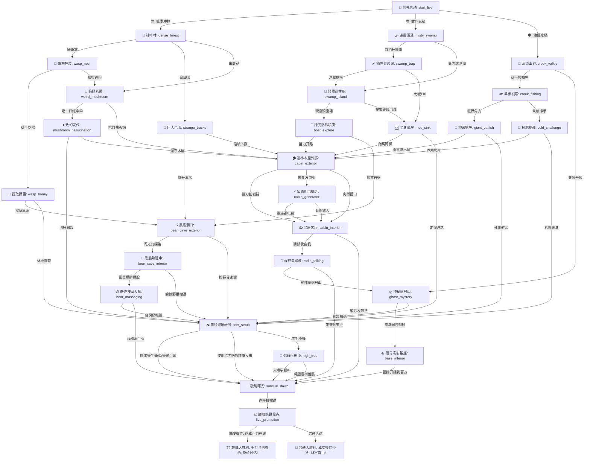

# 🌲 荒野大求生：百万粉丝巅峰直播——关卡剧情拓扑图与策划指南

为了方便您分析、查看和维护该新剧本的网状探索关系，我们特为您绘制了本份拓扑图与通关指南。

---

## 🗺️ 关卡核心拓扑流程图 (Mermaid)

您可以使用 Markdown 渲染工具或 Mermaid 渲染插件直接预览以下精彩的流向图：

---

## 🎒 关键道具与状态线索映射表

我们在不修改核心引擎的前提下，完美复用了原本的 `ITEM_ICONS` / `effects` 标志系统：

| 游戏内标识 (effects) | 包装概念 | 对应功能说明 |
| :--- | :--- | :--- |
| `has_food` | **野生蜂蜜 / 烤鲶鱼 / 野果** | 可在 `tent_setup` 中扔出，用来将野狼群引开，免于死亡/扣血直接迎接入晓。 |
| `has_key` | **生存猎刀 / 登山扣 / 防熊喷雾** | 可用于直接割断巡林木屋的链条锁，或者在狼群围攻时用于安全防身。 |
| `has_cables` | **高压绝缘铜电缆线** | 在发电机房中不可或缺的道具，能让你顺利修复柴油机，恢复木屋供电。 |
| `generator_on` | **发电机成功送电** | 触发古董收音机指示灯变绿，开启调频破译【走近科学】外星人基座隐藏任务线。 |
| `has_million_fans`| **百万粉丝在线成就** | 最终完美通关结局的钥匙，在基座里完成最终带货直播前触发。 |

---

## 🏆 通关成就与爆笑社死退赛档案

在黑瞎子岭中，您可以体验到极具现代黑色幽默的十多种花式淘汰（退赛）档案，它们会被自动记录在**死亡纪念馆**中供玩家收集：

1. **【大社死：幻觉大跳猴戏】**
   * *达成方式*：在 `weird_mushroom` 节点吃下彩菌，在致幻状态下在直播间疯狂整活和松鼠结拜，直播间因“传播封建迷信”遭平台永久封禁。
2. **【悲催淘汰：香肠大嘴】**
   * *达成方式*：在 `wasp_nest` 节点尝试徒手大口吃野生蜂蜜，喉头严重水肿，当场窒息被医护直升机拉走退赛。
3. **【硬碰硬淘汰：被熊一巴掌拍断腰】**
   * *达成方式*：在 `bear_cave_interior` 中为了 50 个火箭强行去摸巨熊的屁股，直接被暴怒的黑瞎子一招神熊摆尾拍出十米。
4. **【巅峰大胜利：签约千万合同】**
   * *解锁条件*：顺着收音机线索攀登信号山，成功通电修复基座，读完考察日记，顶住电磁干扰直播到天亮。
